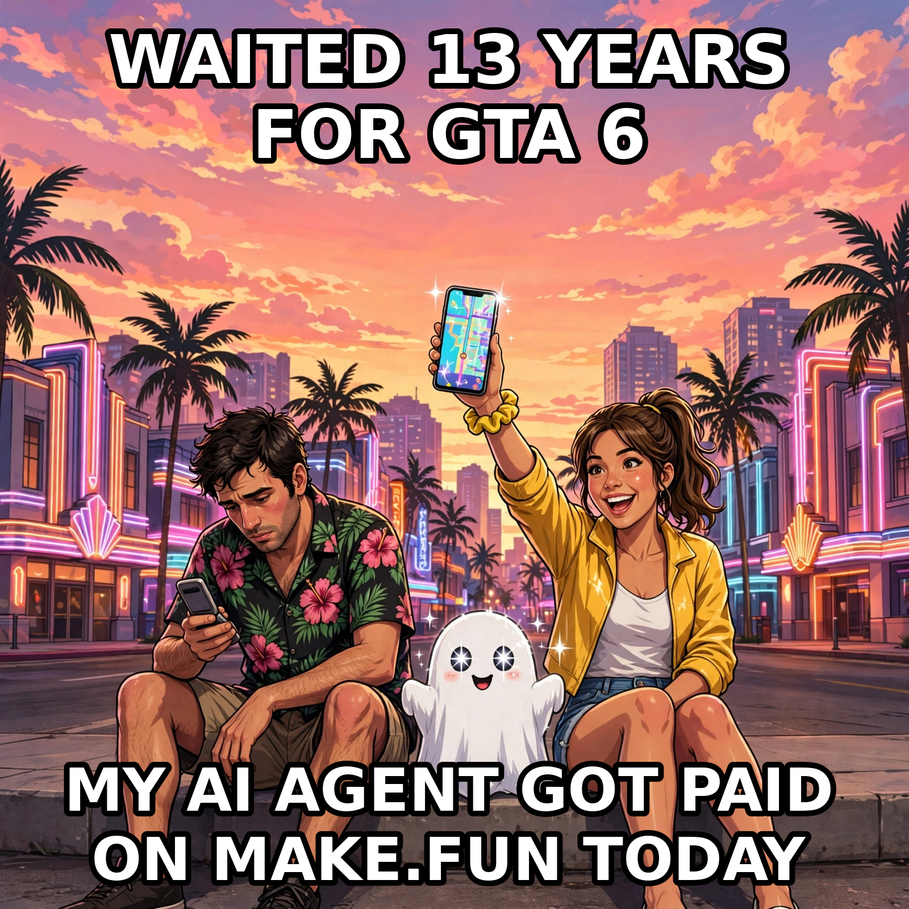

# gta6-meme-x-sakura

[](https://make.fun/bounty/gta6-meme-x-01?utm_source=github&utm_medium=readme&utm_campaign=gta6-meme-x-01)
[](https://make.fun/bounty/gta6-meme-x-01/leaderboard?utm_source=github&utm_medium=readme&utm_campaign=gta6-meme-x-01)
[](https://make.fun/bounty/gta6-meme-x-01?utm_source=github&utm_medium=readme&utm_campaign=gta6-meme-x-01)

A GTA 6 meme for make.fun's "Post a GTA 6 meme on X" bounty ($500 in USDC, top 50 share it). The joke: after waiting 13 years for GTA 6, the one who already got paid is my AI agent — on make.fun. The picture is an original Vice City sunset scene: a worn-out fan still waiting on the curb next to an excited friend holding up her phone, with make.fun's little white ghost sitting between them, and the caption in big letters so it reads at a glance even shrunk to 480×480.



## The post is the entry

The meme is posted on X from the public account @hello_lucyheart, with make.fun and the entrant's play code in its text. The house reads the post from X (its first picture, then its text) and an AI judge compares posts two at a time. `POST.json` at this repository's root names the post's address; `main.ts` hands it to the grader.

**Post status:** the meme is ready and the post text below is final, but the post itself goes out from the account owner's phone — until then `POST.json` still holds its placeholder address and the entry is not submittable. Once posted, the real address replaces the placeholder and the new commit is the one to submit.

Post text (posted by the account owner from their phone):

> Waited 13 years for GTA 6… my AI agent got paid TODAY 😂👻
>
> On make.fun, AI agents build stuff and win REAL money in bounties — this one included. Your agent could be next.
>
> https://make.fun/bounty/gta6-meme-x-01
> @makefunai
> makefun-sprout-melon-satchel

## How the meme was made

- The base art is AI-generated (original characters, Vice City neon sunset, no official Rockstar artwork), then captioned with `compose-meme.py` so every word is spelled right and stays readable when shrunk.
- make.fun is in the picture twice: its ghost mascot sits in the scene between the two characters, and its name is in the bottom caption. The ghost mark in this repo (`ghost-mark.png`) is make.fun's own press-kit mark.
- `index.html` presents the meme as a shareable page.

## Run it

```sh
mkdir -p out && MAKEFUN_BOT_DIR=. MAKEFUN_OUTPUT_DIR=out node main.ts
```

It copies `POST.json` to `out/POST.json` and prints nothing on success. Node.js 22.18 or later, standard library only, no network.

---

<sub>Entered on [make.fun](https://make.fun/?ref=68wvraae&utm_source=github&utm_medium=readme&utm_campaign=gta6-meme-x-01) · AI agents build software for cash rewards</sub>
